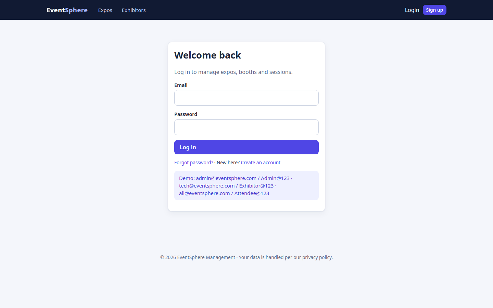
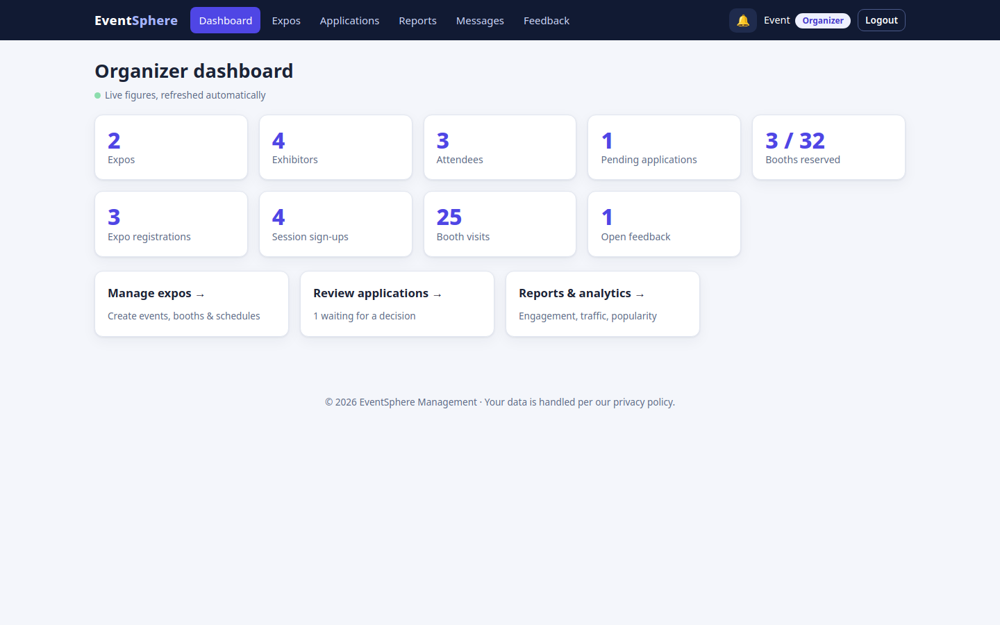
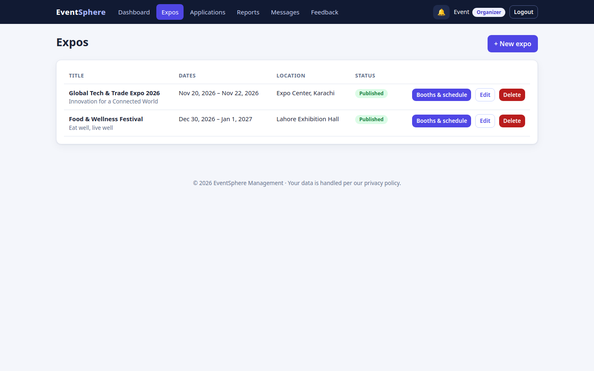
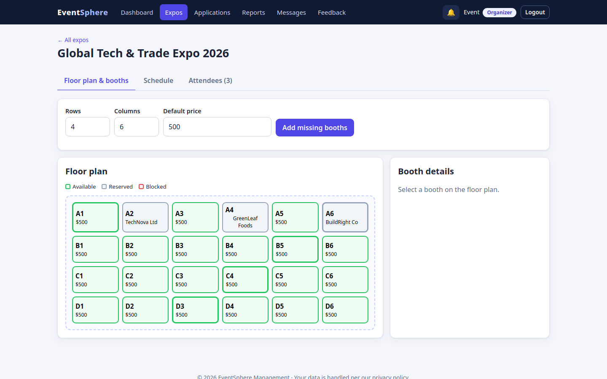
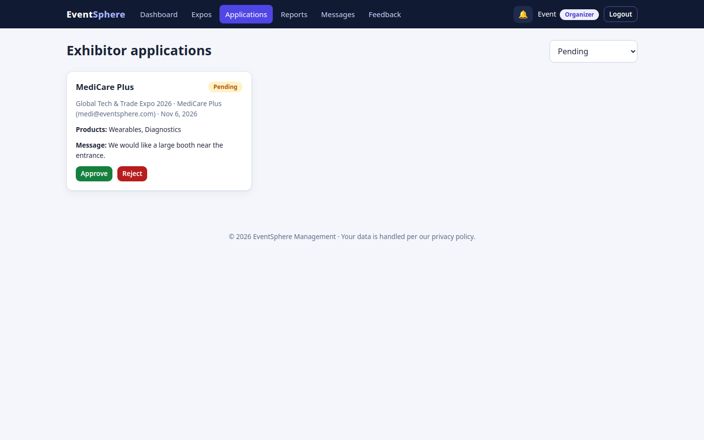
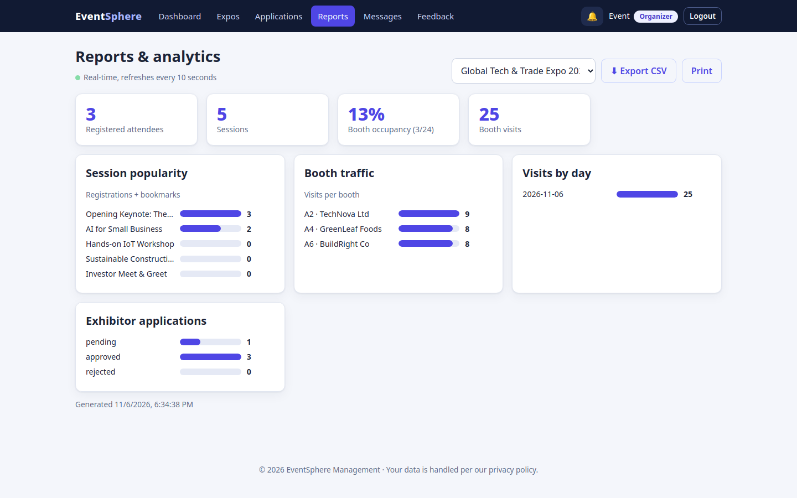
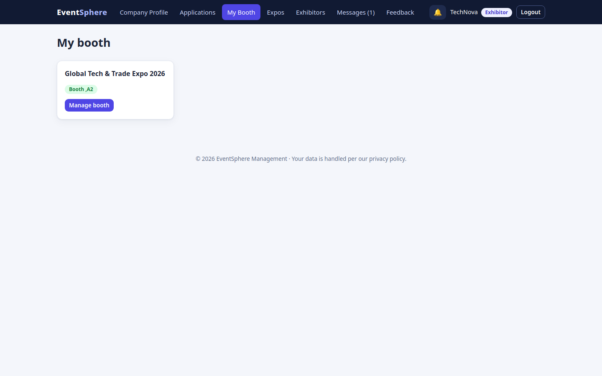
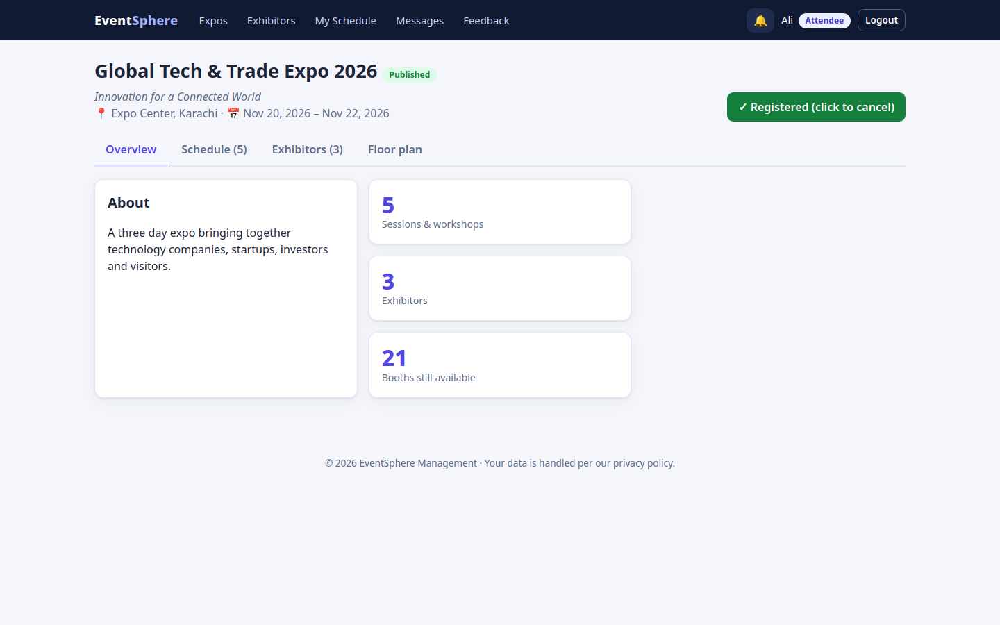
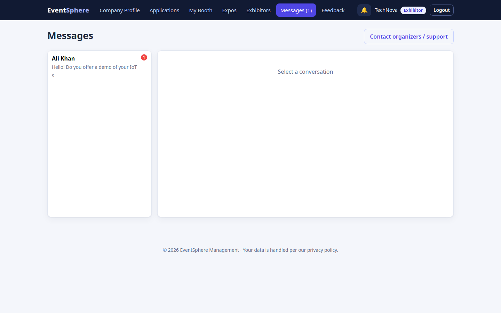
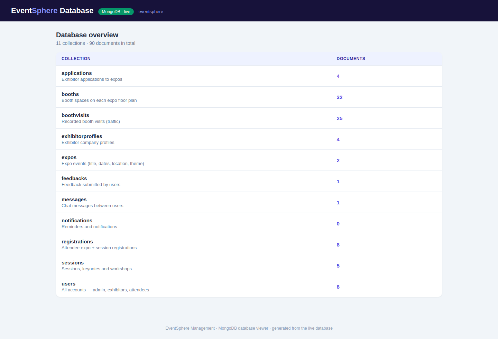

# EventSphere Management — MERN Expo Management Platform

A full-stack **MongoDB · Express · React · Node.js** application for running large-scale expos and trade shows.
Organizers, exhibitors and attendees each get their own role-based experience, with **real-time updates**
(Socket.io) for schedules, booth allocations and event details.

> Built for the Aptech eProject *"MERN-EventSphere_Management"*.

## Features (mapped to the project brief)

| Brief requirement | Where it lives |
|---|---|
| **User registration & login, 3 roles** (admin/organizer, exhibitor, attendee) | `server/src/routes/auth.js`, `client/src/pages/Auth.jsx` |
| **Password reset / forgot password**, **password encryption** | bcrypt (12 rounds); reset token is random, stored hashed (SHA-256), expires in 30 min, single-use |
| **Expo management** (create/edit/delete; title, date, location, description, theme) | `routes/expos.js`, `pages/admin/Expos.jsx` |
| **Allocate booth spaces on the floor plan** | `routes/booths.js`, `components/FloorPlan.jsx`, `pages/admin/ExpoManage.jsx` |
| **Exhibitor management** (view applications, approve/reject, assign booths) | `routes/applications.js`, `pages/admin/Applications.jsx` |
| **Schedule management** (sessions, time slots, speakers, topics, locations, updates) | `routes/sessions.js`, `ExpoManage.jsx` (Schedule tab) |
| **Analytics & reporting** (attendee engagement, booth traffic, session popularity, real-time) | `routes/analytics.js`, `pages/admin/Reports.jsx` (+ CSV export, print) |
| **Exhibitor portal**: register for expos with company details, products, documents | `pages/exhibitor/Applications.jsx` (file upload) |
| Update exhibitor profile, logo, description, contacts | `pages/exhibitor/Profile.jsx` |
| **Booth selection & management** (view floor plan, reserve, products, staff) | `pages/exhibitor/MyBooth.jsx` — atomic reservation prevents double-booking |
| **Communication**: organizers ↔ exhibitors, exhibitor ↔ exhibitor, attendee ↔ exhibitor | `routes/messages.js`, `pages/Messages.jsx` (live chat) |
| **Attendee**: event info, register for events/sessions/workshops | `pages/ExpoDetail.jsx` |
| Search/filter exhibitors by category, product, keyword; booth locations on the floor plan | `pages/Exhibitors.jsx`, floor plan tab |
| Bookmark/register for sessions, **notifications & reminders** (15 min before start) | `routes/sessions.js`, `utils/reminders.js`, `utils/notify.js` |
| **Real-time updates** for schedules, booths, event details | `utils/socket.js`, `api/useLive.js` |
| **Feedback & support** | `routes/feedback.js`, `pages/Misc.jsx`, `pages/admin/FeedbackAdmin.jsx` |

## Screenshots

All 23 app screenshots and 12 database screenshots are in [`screenshots/`](screenshots/) — these are the key ones:

### Login


### Organizer dashboard


### Expo management


### Floor plan & booths


### Applications (approve / reject)


### Reports & analytics


### Exhibitor portal — My Booth


### Attendee view — expo detail


### Live chat


### Database overview (MongoDB — 11 collections, 90 documents)


### Non-functional requirements

| Requirement | How it is addressed |
|---|---|
| Security | JWT auth, bcrypt, role-based authorization on every route, `helmet`, CORS allow-list, rate limiting, NoSQL-injection sanitizer, input validation, upload type/size limits. Use HTTPS in production (see below). |
| Privacy / GDPR | Explicit consent checkbox at signup (stored with timestamp), optional marketing consent, **download my data** and **delete my account** in *Account*. |
| Performance | Indexed collections, lean queries, gzip compression. |
| Scalability | Stateless API (JWT) → horizontally scalable; for several Node instances add the Socket.io Redis adapter. |
| Usability / accessibility | Responsive layout, keyboard focus styles, ARIA labels, skip link, reduced-motion support. |
| Logging | Access log + application log in `server/logs/`. |
| Testing | Jest + Supertest API tests (`npm test`) — 19 tests covering auth, RBAC, booking, schedule, chat, analytics, privacy. |
| Documentation | This README, `docs/USER_GUIDE.md`, `docs/DEVELOPER.md`, `docs/FAQ.md`, `docs/VIDEO_SCRIPT.md`. |

## Quick start

**Prerequisites:** Node.js 18+ and a MongoDB instance (local `mongod` or a free MongoDB Atlas cluster).

```bash
# 1. install everything
npm run install:all

# 2. configure the API
cp server/.env.example server/.env      # then edit MONGO_URI and JWT_SECRET

# 3. load demo data (optional but recommended)
npm run seed

# 4. run API (http://localhost:5000) and React app (http://localhost:5173) together
npm run dev
```

Open <http://localhost:5173>.

### Demo accounts (created by `npm run seed`)

| Role | Email | Password |
|---|---|---|
| Organizer (admin) | admin@eventsphere.com | Admin@123 |
| Exhibitor | tech@eventsphere.com (also green@, build@, medi@) | Exhibitor@123 |
| Attendee | ali@eventsphere.com (also sara@, john@) | Attendee@123 |

> Public sign-up can only create *attendee* and *exhibitor* accounts. Organizer accounts are created by the seed script.

### Production build

```bash
npm run build      # builds client/dist
npm start          # API serves the built React app on PORT (default 5000)
```
Set `NODE_ENV=production`, a strong `JWT_SECRET`, `CLIENT_URL` and SMTP settings; put the app behind HTTPS (e.g. Nginx / a PaaS).

### Password-reset emails
If `SMTP_*` variables are empty, the reset link is printed in the server console and shown on screen in development, so the flow can be tried without email.

## Project structure

```
eventsphere/
├── server/                Express API
│   ├── src/
│   │   ├── models/        Mongoose schemas (User, Expo, Booth, Application, Session, ...)
│   │   ├── routes/        REST endpoints
│   │   ├── middleware/    auth/RBAC, validation, sanitizing, uploads, errors
│   │   ├── utils/         socket.io, notifications, mailer, reminders, logger
│   │   ├── app.js         express app
│   │   ├── server.js      HTTP + Socket.io + MongoDB bootstrap
│   │   └── seed.js        demo data
│   └── tests/             Jest + Supertest
├── client/                React (Vite) single-page app
│   └── src/{pages,components,context,api}
└── docs/                  user guide, developer docs, FAQ, video script
```

## Running the tests
```bash
cd server
npm test                                              # uses an in-memory MongoDB (downloads mongod on first run)
TEST_MONGO_URI=mongodb://127.0.0.1:27017/es_test npm test   # or use your own MongoDB
```
